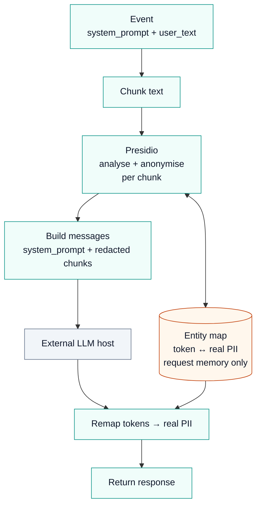

# Redact PII locally before calling external LLMs

*The LLM data firewall pattern*

## Whats the benefit?

Cloud LLM APIs are useful, but the prompt is still data leaving your network. Customer records, tickets, medical notes, HR files, and support logs often contain names, emails, phone numbers, addresses, and IDs. Once that text hits a third-party API, you are relying on the provider’s retention, training, and subprocessors — not on controls you own.

This allows us to **detect and replace PII on your side with local, non-generative models**, send only tokenised text to the external model, then **restore real values in the response** if the user needs them.

The goal of this is protecting sensitive data from external providers along with accidental leaks through logging and prompts, We are not trying to protect against wider application compromise or malicious users with this approach.

## How do we identify the risky data?

I'd avoid using an LLM to find the PII in the first place. Regex and local NER are usually enough for the first pass. Replace the values with stable tokens, send that to the model, and restore them afterwards if the response actually needs them.

- **Rules / regex** for high-precision formats (emails, phone numbers, credit cards, Australian TFNs/ABNs with care, Medicare-style patterns where appropriate)
- **Named-entity recognition (NER)** with libraries such as spaCy (or similar) for people, organisations, and locations
- **Frameworks that combine both**, e.g. Microsoft Presidio (analyser + anonymiser) with a local NLP backend
- Optional **custom recognisers** for your domain (member numbers, booking refs, internal usernames)

## The pipeline

1. **Ingest** the document, ticket, or chunk you were about to put in a prompt.
2. **Analyse** with local detectors → list of spans (type, start/end, score).
3. **Anonymise** by substituting stable placeholders, e.g. `[PERSON_1]`, `[EMAIL_2]`, `[PHONE_3]`.
4. **Call** the external LLM with the redacted prompt only.
5. **Deanonymise** the model output by mapping placeholders back to original values (only if that is safe and intended for the recipient).

Keep a **session-scoped map** of placeholder → original value. Do not log the map alongside prompts in systems that sync to the cloud.

### Substitution style

Prefer **consistent identifiers per entity within a request** so the model can still reason (“ask `[PERSON_1]` to confirm `[EMAIL_1]`”) without seeing real data. Avoid random gibberish that destroys coreference.

Example:

| Original | Sent to LLM |
|----------|-------------|
| Call Jane Smith on 0412 345 678 about order 8821 | Call `[PERSON_1]` on `[PHONE_1]` about order `[ORDER_1]` |

## Design choices worth deciding early

- **Redact vs pseudonymise:** Full redaction (`[REDACTED]`) is safer but hurts task quality. Typed placeholders usually strike a better balance.
- **What you send back to the user:** Sometimes the answer should stay tokenised (e.g. shared logs). Sometimes you rehydrate for a trusted operator only.
- **Chunking:** Run detection per chunk before embedding or RAG retrieval so vectors and prompts never hold raw PII.
- **False positives / negatives:** Tune score thresholds; add allowlists for product names; review high-risk categories manually at first.
- **Provider settings:** Still disable training on prompts where the vendor allows it — local redaction is defence in depth, not a free pass.

## Sketch: Python Lambda with Presidio

One concrete shape: a Lambda (or any short-lived Python worker) that owns redaction and rehydration. The LLM host only ever sees tokenised text.



Only the redacted path crosses to the LLM host. Keep the **entity map in memory for the request only** — do not write it to CloudWatch, S3 prompt logs, or the model provider.

### Handler outline

```python
# Sketch only — not production code.
from dataclasses import dataclass, field
from typing import Callable

from presidio_analyzer import AnalyzerEngine

analyzer = AnalyzerEngine()   # cold start: load spaCy / recognisers once

@dataclass
class EntityMap:
    token_to_value: dict[str, str] = field(default_factory=dict)
    value_to_token: dict[str, str] = field(default_factory=dict)
    counters: dict[str, int] = field(default_factory=dict)

    def token_for(self, entity_type: str, value: str) -> str:
        key = f"{entity_type}:{value}"

        if key in self.value_to_token:
            return self.value_to_token[key]

        n = self.counters.get(entity_type, 0) + 1
        self.counters[entity_type] = n

        token = f"[{entity_type}_{n}]"
        self.value_to_token[key] = token
        self.token_to_value[token] = value

        return token


def chunk_text(text: str, max_chars: int = 3_000) -> list[str]:
    # Prefer splitting on paragraphs / sentences so entities are not cut mid-span.
    ...


def redact_chunks(chunks: list[str], entity_map: EntityMap) -> list[str]:
    redacted = []

    for chunk in chunks:
        results = analyzer.analyze(text=chunk, language="en")

        out = chunk
        for r in sorted(results, key=lambda r: r.start, reverse=True):
            span = chunk[r.start:r.end]
            token = entity_map.token_for(r.entity_type, span)

            out = out[:r.start] + token + out[r.end:]

        redacted.append(out)

    return redacted


def rehydrate(text: str, entity_map: EntityMap) -> str:
    for token, value in entity_map.token_to_value.items():
        text = text.replace(token, value)
    return text


def handler(event, context):
    entity_map = EntityMap()

    system_prompt = event["system_prompt"]          # trusted instruction, no customer PII
    raw_user_text = event["user_text"]              # may contain PII
    call_llm: Callable = resolve_llm_host(event["llm_host"])  # OpenAI / Bedrock / etc.

    chunks = chunk_text(raw_user_text)
    safe_chunks = redact_chunks(chunks, entity_map)
    safe_user_text = "\n\n".join(safe_chunks)

    # Only tokenised content leaves the Lambda toward the LLM host.
    response = call_llm(
        messages=[
            {"role": "system", "content": system_prompt},
            {"role": "user", "content": safe_user_text},
        ]
    )

    return {
        "statusCode": 200,
        "body": rehydrate(response["content"], entity_map),
        # Optional debug for trusted callers only — never log this in prod:
        # "tokens_used": list(entity_map.token_to_value),
    }
```

### Chunking note

Presidio works on spans inside a string. Large payloads should be split **before** analyse/anonymise so you stay under Lambda memory/time limits and model context. Share one `EntityMap` across chunks so `Jane Smith` in chunk 1 and chunk 3 both become `[PERSON_1]`. If a split would cut through a likely entity, back up to the previous sentence boundary.

### Where this runs

| Piece | Where |
|-------|--------|
| Presidio + spaCy model | Inside the Lambda image / layer (VPC optional) |
| Entity map | Request memory only |
| System prompt | Passed in or loaded from your config store |
| LLM host | External HTTPS call after redaction |
| Remap | Same Lambda invoke, before the response leaves |

Cold start cost is mostly loading the NLP model — package a slim spaCy pipeline, reuse the global `AnalyzerEngine` across warm invokes, and keep chunk size predictable so timeouts stay boring.

## What this doesn't cover

Redacting PII doesn't protect against prompt injection, and it doesn't guarantee that sensitive information can't be inferred from context. Treat documents and retrieved content as untrusted input, and enforce tool permissions independently of the model.

A full firewall should also cover more than prompts: embeddings, file uploads, tool arguments, and telemetry can all leak sensitive data. If detection fails, don't silently fall back to sending the original content. For sensitive workloads, fail closed.

Finally, validate the model's response before rehydrating tokens. The model can invent or misuse placeholders, and rehydration can reintroduce the data you're trying to protect.

## Concerns or considerations

- Local NER will miss novel or obfuscated PII; combine with format detectors and human review for high-stakes data.
- Free text like “my mum in Margaret River” can leak identity indirectly even after names are stripped — threat-model the residual risk.
- Rehydration must not happen in a channel less trusted than the original data store.
- This is not legal advice; map the pattern to your obligations (Privacy Act, APP, sector rules, contracts).

## When I’d use this

- Support and ops tools that summarise or draft replies from real tickets
- Internal copilots over CRM / EHR-adjacent exports
- RAG over customer documents where embeddings and prompts must stay scrubbed
- Any demo or vendor evaluation where raw production data must never leave the building
- In countries or regions like the EU where processing any kinds of real user data via LLM/AI can trigger extra legal risk.
